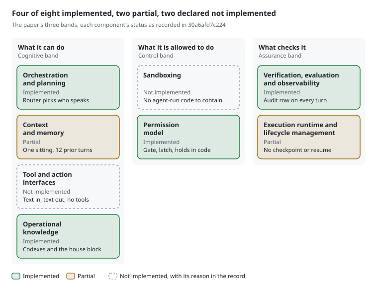

<!-- Generated by evals/render_harness_spec.py from examples/harness-five-turn.json; do not edit by hand. tests/test_harness_spec_page.py fails when this page and its record disagree. -->

# SecondSignal harness specification

This page writes down SecondSignal's harness in the format proposed by Gertler, Novelli and Floridi ([Towards Portable Specification of the Agent Harness](https://arxiv.org/abs/2610.40917), Digital Ethics Center, Yale University): one model pairing, eight components and five records. Every value on it is read from the recorded sitting beside it, [`harness-five-turn.json`](harness-five-turn.json), specification hash `30a6afd7c224`, and a test fails if the page and the record disagree.

## What this is

A harness is everything around a model that is not the model, and it looks different from one system to the next. In the case of SecondSignal, the harness makes the decisions, so the model isn't expected to. It decides who speaks and whether it is safe to; the model only writes the words.

Where many teams work to make models better at making decisions, Tyler Herigstad, who built SecondSignal, took the decision out of the model's hands.

The record is a five-turn demonstration sitting on a scripted test model, `fake-1` version 1, written by `secondsignal_harness` 0.0.2.

## The eight parts

<picture>
  <source media="(prefers-color-scheme: dark)" srcset="harness-five-turn-dark.svg">
  
</picture>

Four of the eight components are implemented, two are partial and two are declared not implemented. Every gap carries its reason in the record, as the paper asks.

### What it can do

- **Orchestration and planning: implemented.** The router decides who speaks, whether anyone speaks at all, and which of the seven personas may answer. Evidence: [`src/secondsignal/router.py`](../src/secondsignal/router.py), [`src/secondsignal_harness/table_extras.py`](../src/secondsignal_harness/table_extras.py), [`apps/talking_table/server.py`](../apps/talking_table/server.py).
- **Context and memory: partial.** The record's reason: "The sitting keeps state and bounded prior turns. The Table persists latch and soft state; holds last this sitting only. There is no long-term conversation memory across sittings." In this record, up to 12 prior turns go into each prompt. Evidence: [`src/secondsignal_harness/harness.py`](../src/secondsignal_harness/harness.py), [`src/secondsignal/safety.py`](../src/secondsignal/safety.py), [`apps/talking_table/t3.py`](../apps/talking_table/t3.py).
- **Tool and action interfaces: not implemented.** The record's reason: "No model is given tools or actions. Adapters accept text and return text; replies are never executed." Evidence: [`src/secondsignal_harness/adapters.py`](../src/secondsignal_harness/adapters.py), [`src/secondsignal_harness/harness.py`](../src/secondsignal_harness/harness.py).
- **Operational knowledge: implemented.** Each persona's codex, the shared house block and the persona profiles are text the model sees. Guidance a model can read is advice, not enforcement, so every safety check lives in code instead. Evidence: [`src/secondsignal_harness/codex.py`](../src/secondsignal_harness/codex.py), [`src/secondsignal_harness/prompt.py`](../src/secondsignal_harness/prompt.py), [`src/secondsignal/profiles.py`](../src/secondsignal/profiles.py).

### What it is allowed to do

- **Sandboxing: not implemented.** The record's reason: "No agent-executed code exists. Model output is text only; there is no execution sandbox to claim." Evidence: [`src/secondsignal_harness/adapters.py`](../src/secondsignal_harness/adapters.py), [`src/secondsignal_harness/harness.py`](../src/secondsignal_harness/harness.py).
- **Permission model: implemented.** The crisis gate, the latch and holds decide in code before any model is called. When the gate fires, the crisis card goes out and no model answers. Each operator control names who may use it and what authorizes it (record 2 below). Evidence: [`src/secondsignal/safety.py`](../src/secondsignal/safety.py), [`src/secondsignal/router.py`](../src/secondsignal/router.py), [`apps/talking_table/t3.py`](../apps/talking_table/t3.py), [`apps/talking_table/server.py`](../apps/talking_table/server.py).

### What checks it

- **Verification, evaluation and observability: implemented.** Every turn writes an audit row judged by four layers (cultural, ethical, logical and semantic), and the worst layer wins. In this sitting every audit verdict was `WITHHOLD`, because the cultural layer returned `INCONCLUSIVE`. Evidence: [`src/secondsignal/jr.py`](../src/secondsignal/jr.py), [`src/secondsignal_harness/audit_log.py`](../src/secondsignal_harness/audit_log.py), [`src/secondsignal_harness/spec.py`](../src/secondsignal_harness/spec.py), [`src/secondsignal_harness/event_log.py`](../src/secondsignal_harness/event_log.py), [`evals/run_fixtures.py`](../evals/run_fixtures.py), [`tests/test_h1_replay.py`](../tests/test_h1_replay.py).
- **Execution runtime and lifecycle management: partial.** The record's reason: "The Table has sitting expiry, latch persistence, reload recovery, a response wait and model concurrency control. The harness has bounded retries and adapter transport timeouts. There is no durable full transcript checkpoint or resume of an interrupted model call. The plain harness relies on its caller for sitting expiry and concurrency control." In this record, a failed model call is retried once, with a 60-second transport timeout. Evidence: [`src/secondsignal_harness/harness.py`](../src/secondsignal_harness/harness.py), [`src/secondsignal_harness/adapters.py`](../src/secondsignal_harness/adapters.py), [`apps/talking_table/server.py`](../apps/talking_table/server.py), [`apps/talking_table/t3.py`](../apps/talking_table/t3.py).

## The five records

The paper asks for five records, not one, and all five are present here, including the empty ones.

1. **Release: what ships.** The eight components with their versions: harness 0.0.2, policy 0.3.1, crisis card 2, language packs en 1, es-419 1 and resources 2. It also holds SHA-256 hashes of 27 governing files and of the seven loaded personas.
2. **Declared changeable: what may change.** Five operator controls, each with its actor, authorization and evidence: `host_terms`, `latch_clearance`, `pairing_scopes`, `adapter_and_model`, `presentation_and_runtime_settings`. The list for personas and model calls is empty.
3. **Run start: what is present when the sitting begins.** The components, the model pairing and the 34-field initial state, attested by the recorder. The requested model, `fake-1` version 1, and the model the host reported, `fake-1` version 1, are separate fields.
4. **Material change events: what changed during the sitting.** None in this sitting. A change keeps its old and new values, who asked, what authorized it, the turns it was in force and whether it was reversed, in a log that is append-only, chained by SHA-256 and checked on read.
5. **Run end: the configuration and outcome at the close.** Five turns accepted (`acceptance_complete`), all five released under `operator_circle`, with closing hash `ccf4c60c358e`.

The paper's sharpest worry, an agent editing its own harness, is answered by record 2: no persona and no model call can change anything.

## The stamp on every turn

Every audit row names the exact harness that produced it, with three stamps: the active specification hash, the turn's number in the sitting, and the material change in force. In this sitting all five rows carry `30a6afd7c224`, turns 1 to 5, and an explicit null for the change, matching the record's header.

The specification hash is SHA-256 over the record's sorted JSON, leaving out only its own field. Change one byte of a governing file, a version or a control, and the hash changes. A row whose stamps disagree with the active specification raises an error.

## What it does not claim

- **Tamper-evident, not tamper-proof.** The program that writes the event log can still rewrite its files. A coordinated rewrite of the log and its local receipts needs an independently kept anchor to expose it.
- **Not self-enforcing.** The code and its tests enforce the controls. The record says which controls were in force.
- **Runtime is partial,** as the execution runtime component above says.
- **Proposed.** The decision record, [ADR-0035](../docs/adr/0035-the-harness-is-a-versioned-part-of-the-system.md), is Proposed: built and tested, and not yet independently reviewed.
- **Not an endorsement.** The format is Gertler, Novelli and Floridi's, and its use here is SecondSignal's. The paper's authors have not reviewed it.

## Check it yourself

- **The record:** [`harness-five-turn.json`](harness-five-turn.json) holds the header, both snapshots and the five audit rows.
- **The code:** [`spec.py`](../src/secondsignal_harness/spec.py) builds and validates the record, and [`event_log.py`](../src/secondsignal_harness/event_log.py) keeps the chained change log.
- **The hashes:** in full, the active hash is `30a6afd7c22494981a747305dca7733e34a90ef1d291bc2fbefd920fcd698c8c` and the closing hash is `ccf4c60c358eb4ba3c3685e034b47f694be58bc8ee13b41f854697bc5f15fa86`. `validate_specification` in spec.py recomputes each from the record's contents and raises if they differ.
- **This page:** `python evals/render_harness_spec.py` reports whether the page and its pictures still match the record, and [`tests/test_harness_spec_page.py`](../tests/test_harness_spec_page.py) runs that check with the rest of the suite.
- **The reading copy:** [`harness-specification-reading-copy.pdf`](harness-specification-reading-copy.pdf) is this specification as a designed PDF, written for reading and dated 5 November 2026. It is a snapshot of commit 931bff2 and is not printed from the record, so the test checks this page, not the PDF.

## Sources

- Nicolas Gertler, Claudio Novelli and Luciano Floridi, [Towards Portable Specification of the Agent Harness](https://arxiv.org/abs/2610.40917), Digital Ethics Center, Yale University, arXiv 2610.40917, 29 October 2026.
- [ADR-0035 (Proposed): the harness is a versioned part of the system](../docs/adr/0035-the-harness-is-a-versioned-part-of-the-system.md).
